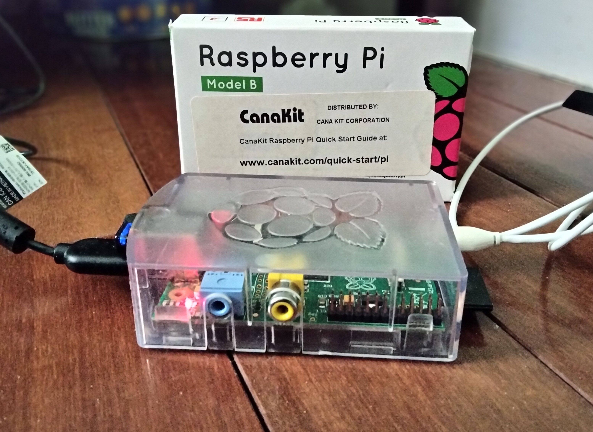
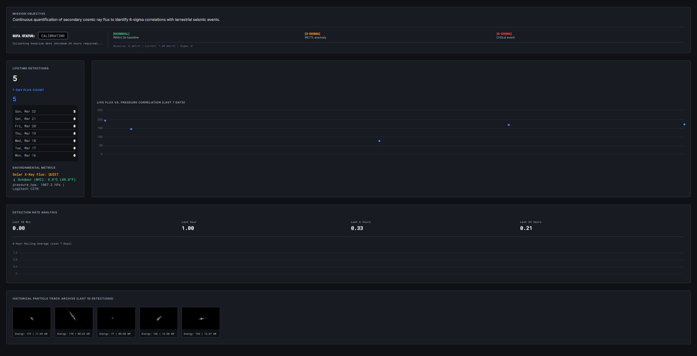

# CMOSmicRay


**CMOSmicRay** is a production-grade cosmic ray detector client for the [CREDO Project](https://credo.science/). It transforms a standard webcam and a Raspberry Pi into a scientific instrument capable of detecting high-energy particle interactions (muons).

This software is optimized for **Legacy Hardware** (e.g., Raspberry Pi Model B) but runs perfectly on modern devices. It features automatic camera driver tuning, fault-tolerant network reporting, 64x64 pixel "Region of Interest" event cropping, and a dynamic local monitoring dashboard.

---

## 🛠️ Hardware Requirements

* **Computer:** Raspberry Pi (Model B, 2, 3, 4, or 5) running Raspberry Pi OS.
  <br>
  
* **Camera:** Logitech C270, C922, or similar UVC-compliant webcam.
* **Lens Cap:** The camera lens **must be completely blocked** (light-tight) using electrical tape or a printed cap.
* **Internet:** Wi-Fi or Ethernet connection for API uploads and Open-Meteo data fetching.

---

## 📊 Live Monitoring Dashboard

CMOSmicRay includes a beautifully designed, dark-mode responsive web dashboard. It continuously tracks the incoming cosmic ray flux and automatically analyzes the stream for statistically significant anomalies (using a rigorous baseline standard). 

The dashboard provides live flux-vs-pressure correlation graphs, lifetime detection statistics, recent particle track event captures, and dynamically pulls real-time environmental metrics (barometric pressure, outdoor temperature, and solar flare data) to display alongside your astronomical hits!



---

## 📦 Installation Instructions

Follow these steps to prepare your Raspberry Pi.

### Step 1: Update System
Ensure your package lists are up to date.
```bash
sudo apt-get update
sudo apt-get upgrade -y
```

### Step 2: Install System Dependencies
We use system-level packages for OpenCV and Video4Linux utilities. This is preferred over pip for Raspberry Pi to avoid long compilation times.
```bash
sudo apt-get install -y python3-opencv python3-numpy python3-requests v4l-utils
```
* **python3-opencv**: The computer vision library.
* **v4l-utils**: Required for the script to auto-tune camera exposure settings (`v4l2-ctl`).

### Step 3: Clone the Repository
Download the production code to your home directory.
```bash
cd ~
git clone https://github.com/jakelee2029/CMOSmicRay.git
cd CMOSmicRay
```

---

## ⚙️ Configuration

The CMOSmicRay uses Environment Variables for security and configuration. 

### Option A: Manual Launch
Run these commands in your terminal before starting the script:
```bash
# Credential Configuration
export CREDO_STATION="Your-Station-Name"
export CREDO_USER="your_credo_username"
export CREDO_PASS="your_credo_password"

# Hardware Configuration (Selects the correct driver profile)
export CREDO_CAMERA_MODEL="C270"  # Options: "C270", "C922", or "Generic"
```

### Option B: The Start Script (Recommended)
Edit the included `start_CMOSmicRay.sh` file to save your credentials permanently:
```bash
nano start_CMOSmicRay.sh
```
You **must** provide your own values for the following variables to correctly identify your detector on the network:
* `CREDO_USER`: Your registered CREDO project username.
* `CREDO_PASS`: Your CREDO project password.
* `CREDO_STATION`: The name you want to assign to this specific detection station.
* `CREDO_DEVICE_MODEL`: The specific hardware model of Raspberry Pi you are running this on (e.g., "RPi 4 Model B", "RPi Zero 2 W").

--- LOCATION CONFIGURATION ---
* `CREDO_LAT`: Your Latitude
* `CREDO_LNG`: Your Longitude
* `CREDO_ALT`: Your Altitude

--- CAMERA SELECTION ---
* `CREDO_CAMERA_MODEL`: "C270" or "C922" - The Python script automagically tunes the drivers

---HARDWARE & SOFTWARE CONFIGURATION ---
* `CREDO_DEVICE_MODEL`: "RPi Model B"

Update these export lines with your actual details, then save (`Ctrl+O`) and exit (`Ctrl+X`).

## 🚀 Usage

### Starting the Detector
To run the detector in the background (production mode), use the start script:
```bash
chmod +x start_CMOSmicRay.sh
./start_CMOSmicRay.sh
```

### The Dashboard
To view your detections locally:
1. Ensure the detection backend `CMOSmicRay.py` is running.
2. Serve the `CMOSmicRay` application folder locally:
```bash
cd ~/CMOSmicRay
python3 -m http.server 8000
```
3. Open `http://<raspberry-pi-ip>:8000/dashboard.html` in your web browser.

### Monitoring
You can watch the logs in real-time to verify detections and system health:
```bash
tail -f CMOSmicRay.log
```
**What to look for:**
* `[HARDWARE] Tuning driver...` -> Confirms camera settings are being applied.
* `[AUTH] Login Successful.` -> Confirms connection to CREDO API v2.
* `[NET] Ping Sent.` -> Confirms the 10-minute heartbeat.
* `[HIT] Energy: ...` -> Confirms a cosmic ray detection.

---

## 🧩 Technical Details

### Universal Driver Logic
The script includes a built-in Hardware Abstraction Layer. Based on the `CREDO_CAMERA_MODEL` variable, it automatically applies the optimal physics profile:

| Profile | Exposure | Threshold | Gain | Notes |
|---------|----------|-----------|------|-------|
| Logitech C270 | 1000 (Long) | 60 (Low) | Max | Optimized for small, noisy sensors. |
| Logitech C922 | 150 (Std) | 95 (High) | Med | Optimized for high-sensitivity 1080p sensors. |
| Generic | 500 | 80 | Med | Fallback for other webcams. |

### Data Privacy
This software only uploads **64x64 pixel crops** of detected particle events. It does not record or transmit full webcam video streams.

---

## ✍️ Authors / Credits
* **Jake Lee** - Original Author & Sole Developer (jakelee2029@gmail.com)

## 🤝 Contributing
Issues and Pull Requests are welcome! Please ensure any code changes maintain support for legacy ARMv6 architecture (Raspberry Pi 1/Zero).

## 📜 License
MIT License.
