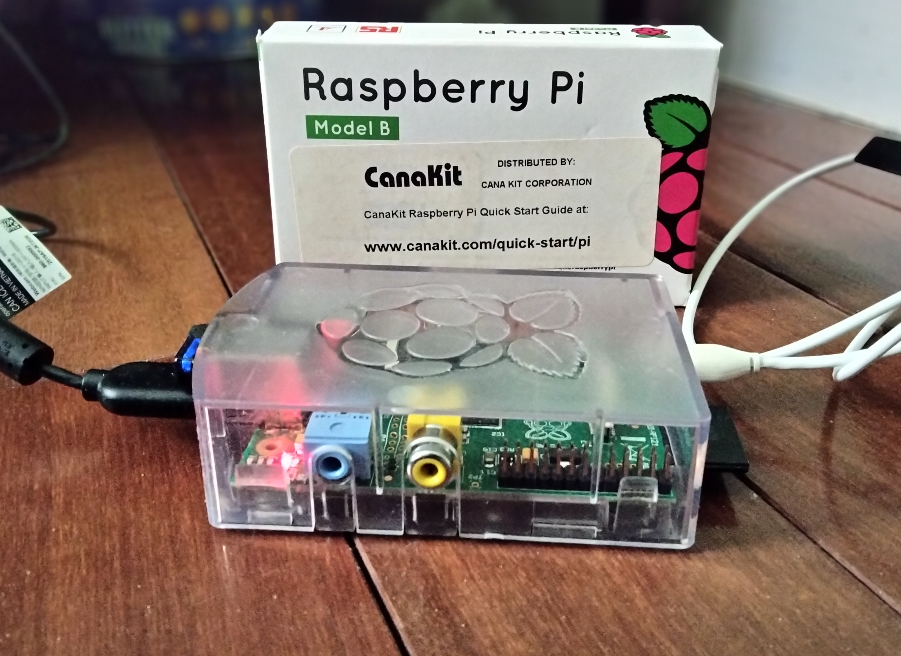
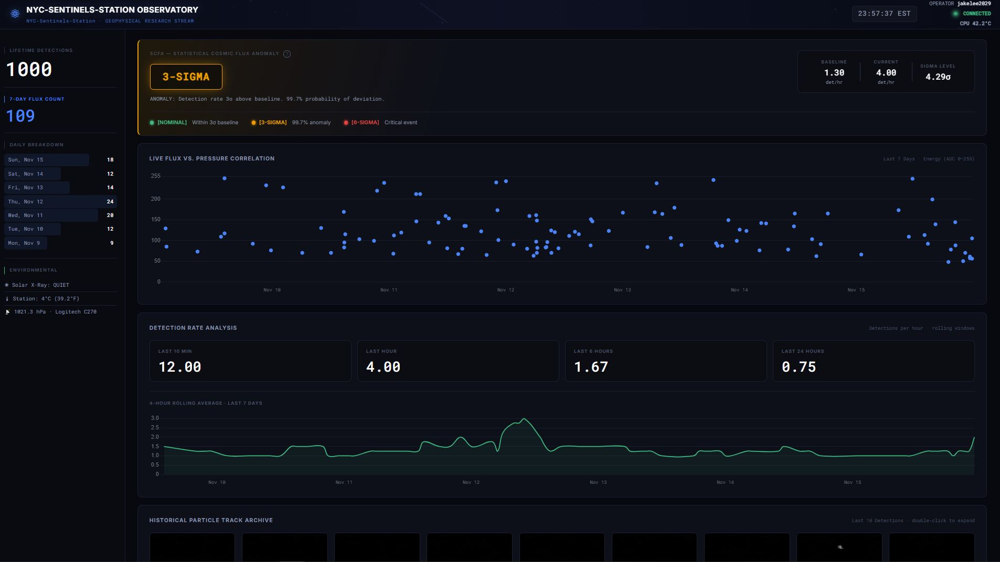

# CMOSmicRay


**CMOSmicRay** is a production-grade cosmic ray detector client for the [CREDO Project](https://credo.science/). It transforms a standard webcam and a Raspberry Pi into a scientific instrument capable of detecting high-energy particle interactions (muons).

This software is optimized for **Legacy Hardware** (e.g., Raspberry Pi Model B) but runs perfectly on modern devices. It features automatic camera driver tuning, fault-tolerant network reporting, 64x64 pixel "Region of Interest" event cropping, and a dynamic local monitoring dashboard.

---

## 🛠️ Hardware Requirements

* **Computer:** Raspberry Pi (Model B, 2, 3, 4, or 5) running Raspberry Pi OS.
  <br>
  
* **Camera:** Logitech C270, C922, or similar UVC-compliant webcam.
* **Lens Cap:** The camera lens **must be completely blocked** (light-tight) using electrical tape or a printed cap.
* **Internet:** Wi-Fi or Ethernet connection for API uploads and Open-Meteo data fetching.

---

## 📊 Live Monitoring Dashboard

CMOSmicRay includes a beautifully designed, dark-mode responsive web dashboard. It continuously tracks the incoming cosmic ray flux and automatically analyzes the stream for statistically significant anomalies (using a rigorous baseline standard). 

The dashboard provides live flux-vs-pressure correlation graphs, lifetime detection statistics, recent particle track event captures, and dynamically pulls real-time environmental metrics (barometric pressure, outdoor temperature, and solar flare data) to display alongside your astronomical hits!



---

## 📦 Installation Instructions

Follow these steps to prepare your Raspberry Pi.

### Step 1: Update System
Ensure your package lists are up to date.
```bash
sudo apt-get update
sudo apt-get upgrade -y
```

### Step 2: Install System Dependencies
We use system-level packages for OpenCV and Video4Linux utilities. This is preferred over pip for Raspberry Pi to avoid long compilation times.
```bash
sudo apt-get install -y python3-opencv python3-numpy python3-requests python3-pip v4l-utils
```
* **python3-opencv**: The computer vision library.
* **v4l-utils**: Required for the script to auto-tune camera exposure settings (`v4l2-ctl`).

### Step 3: Clone the Repository
Download the production code to your home directory.
```bash
cd ~
git clone https://github.com/credo-science/credo-cmosmicray-raspberry-pi-model-b.git CMOSmicRay
cd CMOSmicRay
```

---

## ⚙️ Configuration

CMOSmicRay loads its configuration from a `.env` file via `python-dotenv`, so your credentials never touch a script that gets committed to git or served by the dashboard's web server.

```bash
cd ~/CMOSmicRay/CMOSmicRay
pip3 install -r requirements.txt --break-system-packages
cp .env.example .env
nano .env
```

Fill in your own values for:
* `CREDO_USER` / `CREDO_PASS`: Your CREDO project login.
* `CREDO_STATION`: The name you want to assign to this detection station.
* `CREDO_LAT` / `CREDO_LNG` / `CREDO_ALT`: Your station's location.
* `CREDO_CAMERA_MODEL`: `"C270"` or `"C922"` — selects the driver tuning profile automatically.
* `CREDO_DEVICE_MODEL`: Your Raspberry Pi model (e.g. `"RPi 4 Model B"`, `"RPi Zero 2 W"`).

`.env` is listed in `.gitignore` — it will never be committed or served by the dashboard's HTTP server. Save and exit (`Ctrl+O`, `Ctrl+X`), then launch with `start_CMOSmicRay.sh` as usual.

## 🚀 Usage

### Starting the Detector
To run the detector in the background (production mode), use the start script:
```bash
chmod +x start_CMOSmicRay.sh
./start_CMOSmicRay.sh
```

### The Dashboard
To view your detections locally:
1. Ensure the detection backend `CMOSmicRay.py` is running.
2. Serve the `public/` folder (never the project root — that's where `.env` lives):
```bash
cd ~/CMOSmicRay/CMOSmicRay
python3 -m http.server 8000 --directory public
```
3. Open `http://<raspberry-pi-ip>:8000/dashboard.html` in your web browser.

> ⚠️ **Do not port-forward 8000 to the public internet.** `python -m http.server` has no authentication or TLS — it's built for trusted local-network use only. `status.json` is served unauthenticated and includes your station's coordinates (rounded to ~1km precision). If you want remote access, put a reverse proxy with auth (e.g. Caddy, Nginx + basic auth) in front of it instead of exposing the port directly.

### Monitoring
You can watch the logs in real-time to verify detections and system health:
```bash
tail -f CMOSmicRay.log
```
**What to look for:**
* `[HARDWARE] Tuning driver...` -> Confirms camera settings are being applied.
* `[AUTH] Login Successful.` -> Confirms connection to CREDO API v2.
* `[NET] Ping Sent.` -> Confirms the 10-minute heartbeat.
* `[HIT] Energy: ...` -> Confirms a cosmic ray detection.
* `[PROFILE] Capture loop: ...` -> Logged every 60s. Shows the detection loop's actual iteration rate and cv2 compute cost on your hardware -- useful if you're evaluating whether the loop needs throttling on constrained devices (Pi Zero/Model B).

To start the detector at boot and bring it back after a halt (lens check or overheating) or a crash, add these to `crontab -e`. The start script does nothing if the detector is already running, so the watchdog is safe to run often:
```bash
@reboot /home/<user>/CMOSmicRay/start_CMOSmicRay.sh
*/5 * * * * /home/<user>/CMOSmicRay/start_CMOSmicRay.sh >> /home/<user>/CMOSmicRay/watchdog.log 2>&1
```
With the lens uncovered the detector restarts about every 5 minutes, calibrates and halts again without uploading anything.

Since `start_CMOSmicRay.sh` redirects output to `CMOSmicRay.log` via `nohup ... >>` with no rotation, that file grows unbounded on an unattended, weeks-long deployment. Install the provided `logrotate` config to cap it:
```bash
# run from the folder that contains CMOSmicRay.py; rewrites the sample path to yours
sed "s#/home/pi/CMOSmicRay/CMOSmicRay#$PWD#" packaging/cmosmicray.logrotate | sudo tee /etc/logrotate.d/cmosmicray
sudo logrotate -f /etc/logrotate.d/cmosmicray   # optional: rotate once now (needs free disk ~ the log's size)
```

---

## 🧩 Technical Details

### Universal Driver Logic
The script includes a built-in Hardware Abstraction Layer. Based on the `CREDO_CAMERA_MODEL` variable, it automatically applies the optimal physics profile:

| Profile | Exposure | Gain | `min_absolute` | `ratio_threshold` / `ratio_min` | Notes |
|---------|----------|------|----------------|---------------------------------|-------|
| Logitech C270 | 660 (Long; the camera caps at 666) | Max | 70 | 3.5 / 45 | Optimized for small, noisy sensors. |
| Logitech C922 | 150 (Std) | Med | 95 | 4.0 / 70 | Optimized for high-sensitivity 1080p sensors. |
| Generic | 500 | Med | 80 | 3.5 / 55 | Fallback for other webcams. |

A candidate is accepted if its peak is `>= min_absolute`, **or** `>= ratio_threshold x` the local background and `>= ratio_min`. In a light-tight enclosure the background is about 1, so the effective acceptance floor is `ratio_min` (45 for the C270).

### Detection Pipeline and Safety Gates
1. **Calibration** -- the first 500 frames only settle the background model; no detection yet.
2. **Lens check** -- mean brightness must be `<= 10` and at least 5% of pixels near-black. Checked at the end of calibration, every 10 minutes, and before every hit is uploaded. On failure the process exits with status 1 and the reason is published in `status.json`. It does not restart itself: use a service manager, or the cron watchdog described under *Monitoring* below, otherwise the station stays offline until restarted by hand.
3. **Candidate scan** -- up to 3 traces per frame; after each accepted trace its 64x64 ROI is blacked out and the frame is re-scanned.
4. **Filters** -- 3x3 spatial test (rejects isolated hot pixels), then the **hot-pixel mask**: any position that yields 5 accepted hits is treated as a sensor defect and masked (`REJECTED_HOT`). Learned positions persist in `hot_pixels.json`, kept separately per capture size.
5. **Thermal protection** -- warning at 60 C, exit at 70 C (checked every 30 s).

### Capture Size
The default is **640x480**. Long-run data showed single-pixel hot spots producing 65% of accepted hits at 1280x720 but 1% at 640x480. Override with `CAPTURE_WIDTH` / `CAPTURE_HEIGHT`; the Pi Model B processes about 6 frames/s at 640x480 versus about 2 at 1280x720.

### Optional Settings (`.env`)
All have defaults; see `.env.example`.

| Variable | Default | Purpose |
|----------|---------|---------|
| `CAPTURE_WIDTH` / `CAPTURE_HEIGHT` | 640 / 480 | Capture size |
| `CALIBRATION_FRAMES` | 500 | Frames before detection starts |
| `OBSCURATION_AVG_MAX` / `OBSCURATION_BLACK_MIN` | 10 / 0.05 | Lens-cover check |
| `THERMAL_SOFT_C` / `THERMAL_CEILING_C` | 60 / 70 | CPU warning / halt |
| `HOT_PIXEL_MIN_HITS` / `HOT_PIXEL_RADIUS` | 5 / 3 | Hot-pixel mask (0 = off) |
| `STATS_WINDOW_S` | 3600 | Live-time log window |
| `STATION_TZ` | auto | IANA timezone (detected from the Pi) |

### Output Files
| File | Contents |
|------|----------|
| `public/detections.json` | Rolling cache (last 1000 hits, with 64x64 image) for the dashboard |
| `detections_archive.jsonl` | Append-only record of every hit (metadata only), never truncated |
| `trace_diagnostics.csv` | Every candidate: `ACCEPTED`, `REJECTED_SPATIAL`, `REJECTED_HOT`, `REJECTED_SENSITIVITY` |
| `live_stats.csv` | One row per window: frames processed, hit counts, and the exposure/gain requested vs. the values the camera reports (it can clamp a request), for rates per live hour |
| `hot_pixels.json` | Learned sensor defects per capture size |
| `public/status.json` | Station state for the dashboard (connection, calibration, CPU temp, alert, timezone) |

Timestamps: detections and the archive use epoch time. The CSVs carry a UTC column plus a station-local column with its UTC offset (e.g. `2026-11-15T19:26:21-05:00`), which stays unambiguous across daylight-saving changes. The dashboard shows station-local time. If a CSV's column layout changes between versions, the old file is kept as `*.legacy-<timestamp>.csv` and a new one started.

### Data Privacy
This software only uploads **64x64 pixel crops** of detected particle events. It does not record or transmit full webcam video streams.

### Running the Tests
The test suite covers the pure config/auth/log logic (no camera or real network needed):
```bash
pip3 install -r requirements-dev.txt
pytest
```

---

## ✍️ Authors / Credits
* **Jake Lee** - Original Author & Sole Developer (jakelee2029@gmail.com)

## 🤝 Contributing
Issues and Pull Requests are welcome! Please ensure any code changes maintain support for legacy ARMv6 architecture (Raspberry Pi 1/Zero).

## 📜 License
MIT License.
